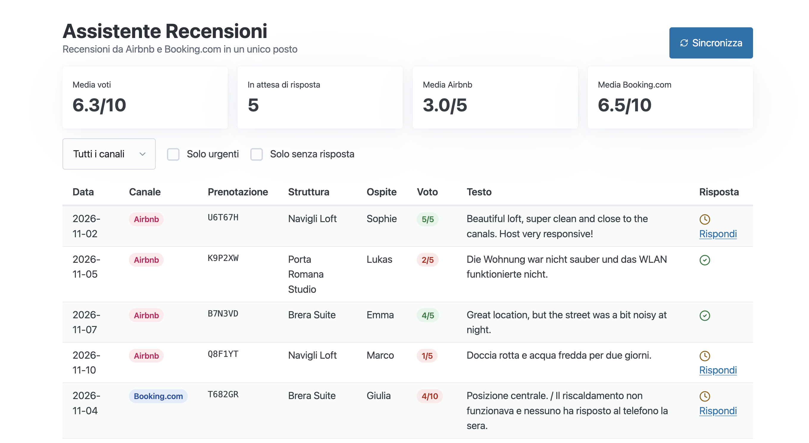
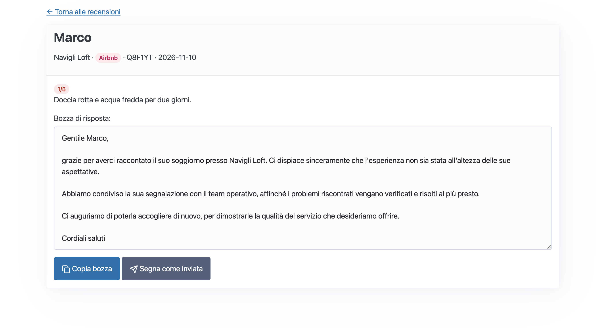

# Assistente Recensioni

Un piccolo "review inbox" in stile PMS (Property Management System): raccoglie le recensioni degli ospiti da **Airbnb** e **Booking.com** in un'unica vista, evidenzia quelle urgenti e aiuta a preparare le risposte.

Progetto personale di studio, costruito passo dopo passo in JavaScript vanilla, partendo dal lavoro quotidiano di gestione delle recensioni nel settore degli affitti brevi.

## Screenshot

**Lista delle recensioni**, con filtri e statistiche:



**Dettaglio di una recensione**, con bozza di risposta:



## Funzionalità

- **Sincronizzazione da due canali (OTA)**: carica le recensioni di Airbnb e Booking.com, che usano formati diversi.
- **Normalizzazione**: converte i due formati in un modello unico (per esempio, voti Airbnb da 1–5 a 1–10 per filtri e statistiche), mantenendo il voto originale per la visualizzazione.
- **Tabella con filtri**: per canale, solo urgenti (voto ≤ 4/10), solo senza risposta. I filtri si combinano.
- **Voto colorato**: rosso, giallo o verde in base al punteggio.
- **Statistiche**: media dei voti totale e per canale, recensioni in attesa di risposta. Si aggiornano in base ai filtri attivi.
- **Pagina di dettaglio** per ogni recensione, con:
  - bozza di risposta proposta in base al voto, modificabile;
  - pulsante **Copia bozza** negli appunti;
  - pulsante **Segna come inviata**, con stato salvato nel browser.

## Tecnologie

- HTML, CSS e **JavaScript vanilla** (moduli ES, `async/await`, `fetch`)
- [Pico CSS](https://picocss.com/) per lo stile di base
- [Lucide](https://lucide.dev/) per le icone
- `localStorage` per salvare lo stato delle risposte
- Dati di esempio in JSON, che simulano le risposte delle API delle OTA

## Struttura del progetto

```
assistente-recensioni/
├── index.html          # lista delle recensioni, filtri e statistiche
├── recensione.html     # dettaglio di una recensione
├── style.css
├── js/
│   ├── dati.js         # caricamento e normalizzazione dei dati
│   ├── stato.js        # risposte inviate (localStorage)
│   ├── statistiche.js  # medie e conteggi
│   ├── bozze.js        # bozze di risposta in base al voto
│   ├── ui.js           # funzioni di visualizzazione condivise
│   ├── lista.js        # logica della pagina con la tabella
│   └── dettaglio.js    # logica della pagina di dettaglio
└── data/
    ├── airbnb.json     # dati fittizi in formato Airbnb
    └── booking.json    # dati fittizi in formato Booking.com
```

## Come avviarlo

Il progetto usa `fetch` e i moduli ES, quindi va aperto tramite un server locale (non con doppio clic su `index.html`).

1. Clona il repository:
   ```bash
   git clone https://github.com/davishka-hikkaduwa/assistente-recensioni.git
   ```
2. Apri la cartella in **VS Code**.
3. Installa l'estensione **Live Server**.
4. Tasto destro su `index.html` → **Open with Live Server**.

Per azzerare le risposte segnate come inviate, nella console del browser:

```javascript
localStorage.removeItem('risposteInviate');
```

## Roadmap

- [ ] Protezione da XSS (niente `innerHTML` con dati esterni)
- [ ] Caricamento in parallelo dei canali con `Promise.all`
- [ ] Gestione degli errori di caricamento
- [ ] Pubblicazione con GitHub Pages
- [ ] Migrazione a **React + Vite**
- [ ] API REST vera (json-server, poi backend Node.js / Express)
- [ ] Bozze di risposta generate con l'AI, nella lingua dell'ospite

## Note

Tutti i dati (ospiti, strutture, codici prenotazione) sono **fittizi** e creati solo a scopo dimostrativo.
